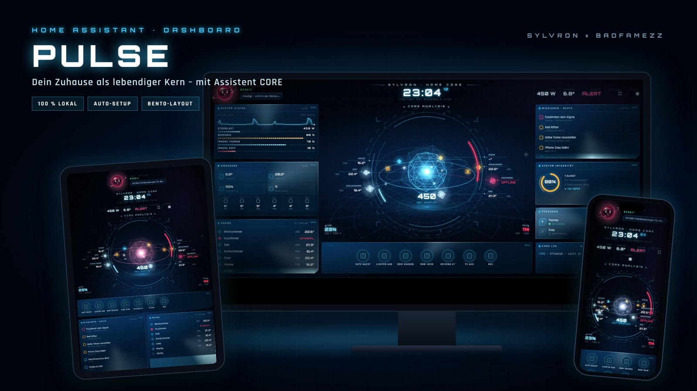

# Sylvron Pulse · Home Core

> **Beta 0.9.1** – looking for testers! Feedback & bugs: GitHub Issues or the Sylvron Discord.



A futuristic HUD card for Home Assistant – your home as a living core, with a local voice assistant (CORE).
Eine futuristische HUD-Karte für Home Assistant – dein Zuhause als lebendiger Kern, mit lokalem Sprachassistenten (CORE).

## Features
- **Zero config** – rooms, temperatures, power, people, batteries, weather, heating, waste collection and quick actions are detected automatically from your areas and entities.
- **System check** – finds and fixes typical setup problems with one click (lamps on switches, devices without a room, entities not exposed to Assist, missing speech recognition / voice).
- **CORE assistant** – animated Holo-Orb mascot, briefings, missions and alerts; speaks with Piper, listens via Whisper (fully local, no cloud).
- **Missions 2.0** – one-click fixes (e.g. heat a cold room), done/snooze, CORE suggests solutions (“Yes” is enough).
- **Solar & battery** – auto-detected from the Energy dashboard: energy flow in the core, battery level, surplus/fault missions, CORE answers solar questions.
- **Waste collection** – reads any waste calendar; no calendar yet? Paste your city's ICS link and CORE sets it up (incl. evening reminder).
- **Room view** – tap a room to control lights, switches, heating and media.
- **Routine editor** – create and edit scripts directly from the card.
- **Bento layout** – drag tiles, resize them, hide/show, templates (Jarvis, Compact, Wall tablet); saved per user on all devices, separate phone layout.
- **Visual editor** – everything configurable in the UI, no YAML needed.
- Deutsch & English (follows your Home Assistant language).
- **Runs offline** – 3D engine and fonts are bundled, no CDN or cloud needed.

## Installation
### HACS (recommended)
1. Home Assistant 2026.11+: Settings → **Marketplace** → *Add via link*. Older versions: HACS → ⋮ → *Custom repositories*. Enter `https://github.com/BadFameZz/sylvron-pulse`, type **Dashboard**.
2. Install **Sylvron Pulse**, reload the browser.
3. Dashboard → *Add card* → **Sylvron Pulse · Home Core**. Done.

### Manual
Copy **all files** from `dist/` to `/config/www/sylvron-pulse/`, add the resource `/local/sylvron-pulse/sylvron-pulse.js` (type *JavaScript module*) under Settings → Dashboards → Resources.

## Minimal config
```yaml
type: custom:sylvron-pulse-card
```
Everything else is optional. Tip: use a **Panel** view for the full HUD.

## Voice (optional, local)
| Part | Add-on | Purpose |
|---|---|---|
| Speech recognition | Whisper | microphone in app & tablets |
| Voice | Piper | natural speech |

Then set both in Settings → Voice assistants. The microphone in the browser requires **https**. The built-in system check tells you what's missing.

## Options
| Option | Default | |
|---|---|---|
| `owner` | your HA user | how CORE addresses you |
| `language` | auto | `de` / `en` |
| `height` | 880 | px |
| `tts_engine` | `tts.piper` | empty = browser voice |
| `auto_discover` | true | |
| `layout` | `jarvis` | start template: `jarvis` / `kompakt` / `wand` |
| `layout_lock` | false | hide the layout button (kiosk) |
| `follow_up` | true | keep listening after CORE asks a question |
| `solar_power` / `battery_power` / `battery_soc` / `grid_power` | auto | override detected energy sensors |
| `grid_power_invert` / `battery_power_invert` | false | flip sign conventions |
| `waste_calendar` | auto | calendar entity (or list) with pickup dates |
| `system_check` | true | daily hint |
| `rooms`, `power`, `persons`, `batteries`, `watch`, `muell`, `actions`, `weather`, `outdoor` | auto | own lists override detection |
| `humidity_high` / `temp_low` / `battery_low` / `stale_hours` | 65 / 17 / 20 / 6 | alert thresholds |

## Background watcher (optional)
The card only works while a dashboard is open. For push notifications when nothing is open (cold room with “heat now” button, ventilate, appliance finished, low battery, device offline), create automations in Home Assistant – examples are in the Sylvron Discord; a blueprint is planned.

## License
MIT © Sylvron / BadFameZz · bundles three.js (MIT) and the Orbitron, Rajdhani and JetBrains Mono fonts (SIL OFL 1.1).
